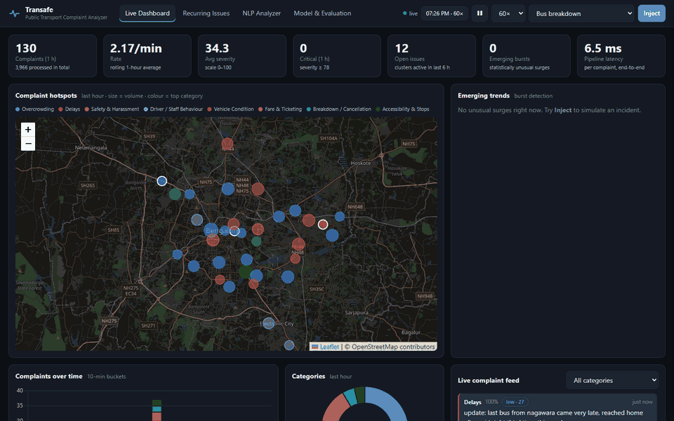
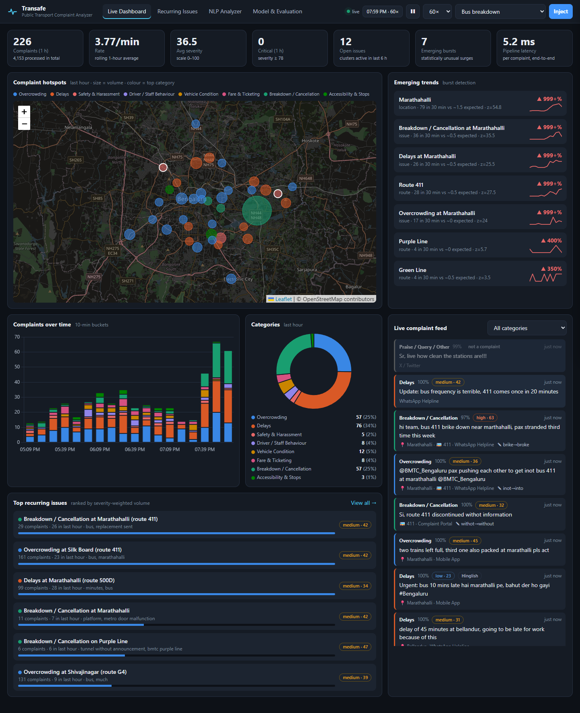
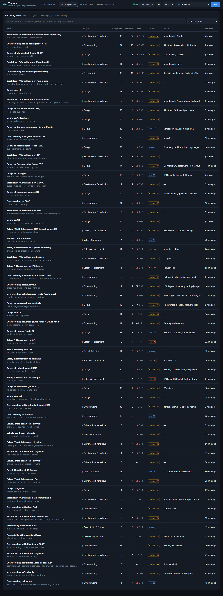
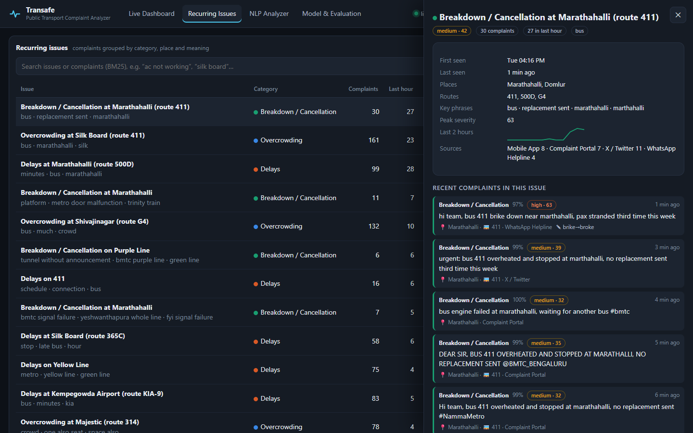
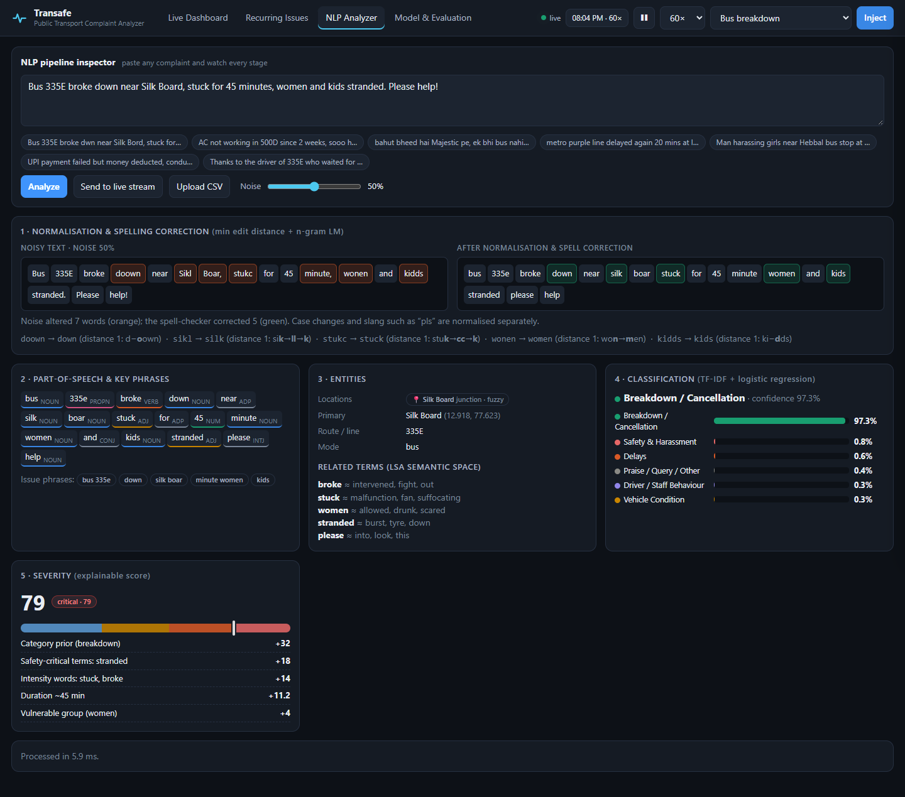
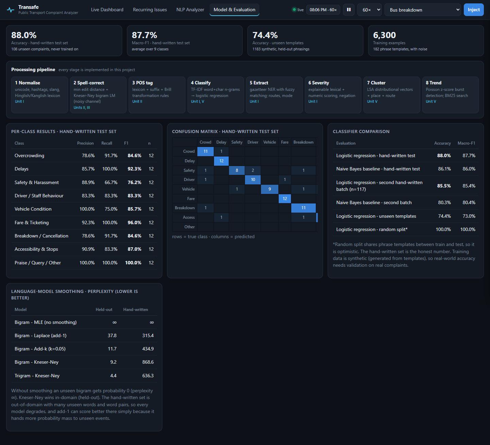

# Transafe - Real-Time Public Transport Complaint Analyzer

[](https://github.com/jordanv25/transafe/actions/workflows/ci.yml)

NLP course project (AI53) · Problem 5: *continuously process incoming passenger complaints and generate live issue
categories, locations, severity levels and emerging trends.*

Built for Bengaluru (BMTC buses + Namma Metro). Complaints arrive as noisy social-media / portal text, sometimes
code-mixed with Hindi or Kannada, and the system turns the stream into something an operations team can act on.



*30 seconds of the live dashboard: a simulated bus breakdown is injected, the burst detector flags it, the hotspot map
and the complaint feed react. The complaints are simulated.*

## What it does

| Requirement | How it is solved |
|---|---|
| **Live issue categories** | TF-IDF (word + char n-grams) → logistic regression, 8 complaint classes + "other" (praise / queries) |
| **Locations** | Gazetteer NER with fuzzy matching (edit distance), BMTC route numbers, metro lines, bus/metro mode |
| **Severity levels** | Explainable 0-100 score: category prior + safety terms + intensity + duration + recurrence + vulnerable groups, with negation and intensifier handling |
| **Recurring issues** | Incremental clustering in an LSA semantic space + place + route |
| **Emerging trends** | Poisson z-score burst detection on category / place / route / category@place, compared with the same 30-minute slot on earlier days (rush hours are not flagged) |
| **Live** | Streaming engine, Server-Sent Events, simulator with incident injection, REST API for real feeds |

Plus: noisy-channel spell correction, Hinglish/Kanglish normalisation, POS tagging and issue phrases, BM25 search, CSV
import/export, SQLite log, an NLP "pipeline inspector" page and a model-evaluation page.

## Run it

```bash
pip install -r requirements.txt
python run.py            # trains models on first run (~15 s), then ~30-60 s of start-up history; opens http://127.0.0.1:8000
python -m pytest -q tests
```

In the UI: press **Inject** (top right) to start an incident such as a bus breakdown at Silk Board; within seconds the
*Emerging trends* panel flags it, the map hotspot grows and a recurring issue appears. Use **NLP Analyzer** to paste
any complaint and see every stage. Move the **Noise** slider there to add typos to the text first and watch the spell
checker repair them (noisy text and corrected text side by side). Change the speed (1×-300×) to compress time.

**Trend baseline and start-up history.** The detector compares the last 30 minutes with the average of the same
30-minute slot on earlier days, once the log holds at least 2 days. So the demo starts with 50 simulated hours of
history (`TRANSAFE_BACKFILL_HOURS`, default 50), which switches the time-of-day baseline on from the first minute. With
less than 2 days of history (for example `TRANSAFE_BACKFILL_HOURS=3`, which starts in a few seconds) it falls back to the
previous 3 hours, which can mistake a normal rush-hour ramp-up for a burst. `TRANSAFE_SEED` changes the simulator's
random seed.

**Docker.**

```bash
docker build -t transafe .
docker run --rm -p 8000:8000 transafe        # then open http://127.0.0.1:8000
```

The image trains the models while it is built. Keys for the optional services go in through
`docker run --env-file .env ...`; `.env` is never copied into the image.

**Your own labelled complaints.** `python scripts/import_csv.py my_complaints.csv` (columns `text,label`) merges them into
`app/data/real_labeled.csv`; the next `python run.py --retrain` then trains on synthetic plus real complaints (the
classifier only). Texts that also appear in the test sets are skipped, and `real_labeled.csv` is git-ignored.

## Architecture

```
 sources (X, portal, WhatsApp, app, CSV, POST /api/complaints)   simulator (rush hours + incidents)
                         \                                      /
                          v                                    v
   raw text -> normalise -> spell-correct -> classify -> extract places/routes -> severity -> POS/phrases
                                                  |
                                                  v
                      cluster (recurring issues) + trend engine (bursts) + BM25 index + SQLite
                                                  |
                                   FastAPI  --SSE-->  dashboard (map, charts, feed, issues)
```

## Syllabus coverage

| Unit | Topic | Where |
|---|---|---|
| I | Challenges of NLP, Indian-language processing | `nlp/preprocess.py` (Hinglish/Kanglish lexicon, noisy text) |
| I | Statistical language model | `nlp/language_model.py` |
| I, V | Information retrieval | `engine/search.py` (BM25), TF-IDF everywhere |
| II | Spelling error detection and correction, min edit distance | `nlp/edit_distance.py`, `nlp/spell.py` |
| II | Rule-based / transformation-based POS tagging | `nlp/pos_tagger.py` |
| II, III | Smoothing, N-grams, entropy / perplexity | `nlp/language_model.py` (MLE, add-1, add-k, Kneser-Ney), Model page |
| III | Context-free grammar | `data/generator.py` (template grammar that generates the training text) |
| V | Distributional semantics | `nlp/models.py` `SemanticSpace` (TF-IDF → SVD / LSA) used for clustering and related terms |

Syntactic parsing (CYK, Unit III) and machine translation (Unit IV) are not used because this problem does not need
them; they could be added (a CYK parser for complaint structure, translation of Kannada/Hindi complaints).

## Results

| Measure | Result | How it was measured |
|---|---|---|
| Accuracy, 9 classes | **88.0%** | 108 hand-written complaints (12 per class), never trained on · `python run.py --retrain` |
| Macro-F1 | **87.7%** | same set |
| Naive Bayes baseline | 86.1% accuracy | same set |
| Accuracy on a second hand-written batch | 85.5% (macro-F1 85.4%, Naive Bayes 80.3%) | 117 complaints (13 per class), written later, templates **not** tuned on its errors |
| Both batches together | 86.7% | 225 complaints |
| Accuracy on unseen templates | 74.4% | synthetic complaints from phrase templates held out of training |
| Time to flag an injected incident | **3.4 min on average** (median 3.0, worst 7.5) | simulated minutes from injection to the place or route appearing in Emerging trends; 24 of 24 incidents detected (6 scenario types × 4 seeds), starting from the demo's 50 h of history, so the time-of-day baseline is on. With only 3 h of history (old fallback baseline) the average was 2.8 min · `python scripts/benchmark.py` |
| Pipeline latency | **about 8 ms per complaint** (mean 7.5, median 7.2) | normalise → spell-correct → classify → places → severity → POS, on the 225 hand-written complaints · AMD Ryzen 7 7840HS, Python 3.12 · `python scripts/benchmark.py`. An earlier run on the same laptop gave 10.1 ms, so it varies with machine load |

The accuracy numbers are produced by `python run.py --retrain` and shown on the **Model & Evaluation** page; the two
speed numbers by `scripts/benchmark.py`. Latency depends on the computer, so expect different values on yours.

### Screenshots

| | |
|---|---|
|  |  |
| *Live dashboard: hotspot map, Emerging trends, charts, feed* | *Recurring issues, ranked by severity-weighted volume* |
|  |  |
| *One issue: timeline and its complaints* | *NLP Analyzer: Noise slider at 50% (typos added, then repaired) and every pipeline stage* |
|  | |
| *Model & Evaluation: per-class results, confusion matrix, smoothing comparison* | |

Regenerate them with `python scripts/capture_demo.py` (see the docstring for the two extra dev packages it needs).

### Limits to state when presenting

* The training data is **synthetic** (generated from templates with injected noise). The hand-written sets are a fairer
  test, but they were written by people (and, for the second batch, by the AI assistant that helped build this
  project) rather than collected from passengers. Template coverage was adjusted after looking at the errors on the
  first batch, so 88% is an estimate, not a guarantee on real complaints; the second batch (85.5%) is the cleaner one.
* **No real complaints are in the data yet.** `scripts/import_csv.py` and the training hook are ready; collect real
  posts and portal entries, label them, and report the numbers on those.
* The live feed is a **simulation** (it reuses the same generator plus the hand-written sentences). The pipeline itself
  is source-agnostic; real data goes in through `POST /api/complaints` or CSV upload.
* The burst detector still raises occasional chance alerts (many entities are tested every few seconds, and the
  baseline is an average of only a few days). The systematic rush-hour false alarm is gone, not every false alarm.
  The demo GIF is from a start with no alerts, picked by `scripts/capture_demo.py`: 6 of the 7 simulator seeds it tried
  showed a chance alert within the first seconds.
* Coordinates in the gazetteer are approximate, and BMTC route numbers are illustrative.

## Google Maps and real data

Both are optional and configured in a git-ignored `.env` (copy `.env.example`).

* **Google Maps.** Set `GOOGLE_MAPS_API_KEY` (Google Cloud project with billing and the *Maps JavaScript API* enabled;
  restrict the key to `http://127.0.0.1:8000/*`). The hotspot map then uses Google Maps with its transit layer, which
  draws Namma Metro and bus lines over Bengaluru. Without a key (or if Google rejects it) the app falls back to Leaflet + OpenStreetMap.
* **Live posts.** Setting `X_BEARER_TOKEN` and/or `REDDIT_CLIENT_ID` + `REDDIT_CLIENT_SECRET` switches Transafe to *live
  mode*: a real-time clock, only real posts, no simulator (incident injection returns 409). `app/ingest/sources.py`
  polls the official APIs for BMTC / Namma Metro / BMRCL posts (X recent search: last 7 days, billed per post read, so
  the default poll is every 15 min; Reddit: `r/bangalore`, `r/bengaluru`). `GET /api/sources` shows each feed's health.
* **BMTC's own complaint channels.** I found no public API or data feed for BMTC's grievance portal, only a web form,
  email and a phone line, so it is not scraped. If BMTC or a researcher gives you an export, upload it as CSV
  (`text` column, optional `source`) on the NLP Analyzer page or `POST /api/complaints/batch`.
* Social posts are *public chatter*, not complaints filed with BMTC. Many will be classified "other" and are filtered
  out of the issue counts. Check each platform's terms before using the data beyond a course project.

## API

| Method | Path | Purpose |
|---|---|---|
| GET | `/api/state` | dashboard snapshot + recent feed |
| GET | `/api/stream` | SSE: `complaint`, `incident`, `snapshot` events |
| POST | `/api/analyze` | full pipeline trace for one text (not stored) |
| POST | `/api/complaints` | ingest one complaint `{text, source}` |
| POST | `/api/complaints/batch` | ingest a CSV with a `text` column |
| GET | `/api/complaints?q=...` | BM25 search; or latest complaints |
| GET | `/api/issues`, `/api/issues/{id}` | recurring issues and their complaints |
| GET | `/api/model` | evaluation metrics |
| POST | `/api/simulator`, `/api/simulator/incident` | pause, speed, inject incident |
| GET | `/api/export.csv` | all processed complaints |

Interactive docs: `http://127.0.0.1:8000/docs`.

```bash
curl -X POST localhost:8000/api/complaints -H 'content-type: application/json' \
  -d '{"text":"Bus 335E broke down near Silk Board, stuck 45 mins","source":"X / Twitter"}'
```

## Project layout

```
run.py                     start server (trains models if needed)
app/main.py                FastAPI routes + SSE
app/engine/                core.py (ingest, snapshot), clustering.py, trends.py, search.py, simulator.py
app/nlp/                   preprocess, edit_distance, language_model, spell, pos_tagger, location, severity, models, pipeline
app/data/                  generator.py (training text), gold_test.py (hand-written test sets), gazetteer.py,
                           real_data.py (loads optional real_labeled.csv, guards against test-set leakage)
app/ingest/                X / Reddit adapters (official APIs only)
static/                    index.html, css/app.css (design tokens at top), js/*.js (one module per page)
scripts/                   import_csv.py (real labelled data), benchmark.py (latency, detection delay),
                           capture_demo.py (screenshots + GIF)
tests/test_nlp.py          unit + API tests
docs/EXPLAINER.md          how every component works, formulas, likely viva questions
docs/*.png, docs/*.gif     demo material used in this README
Dockerfile                 container image (python:3.12-slim)
../.github/workflows/ci.yml   runs pytest on every push
```

## Restyling the UI

All colours, spacing and fonts are CSS variables at the top of `static/css/app.css`; category colours live in
`app/config.py`. Each page is one JS module in `static/js/`, so layout changes stay local.
